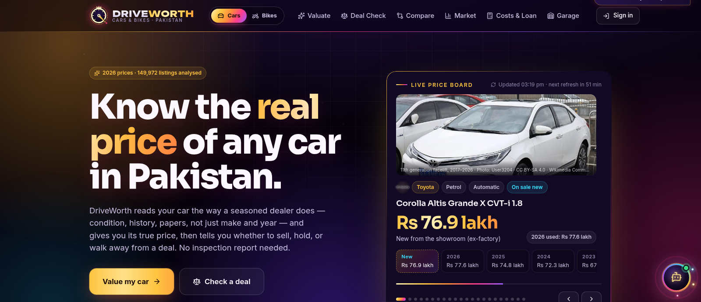
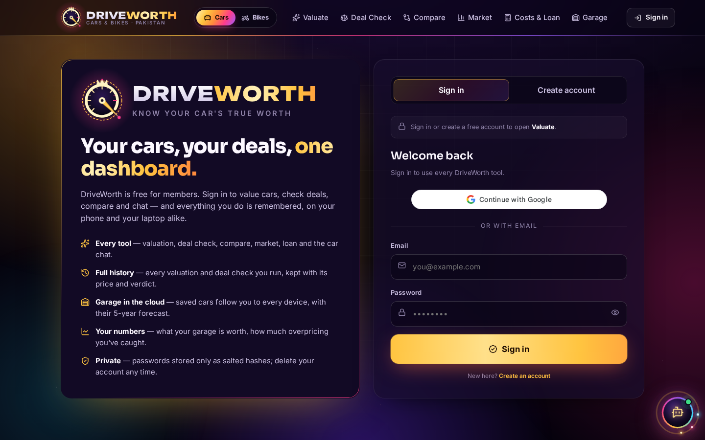
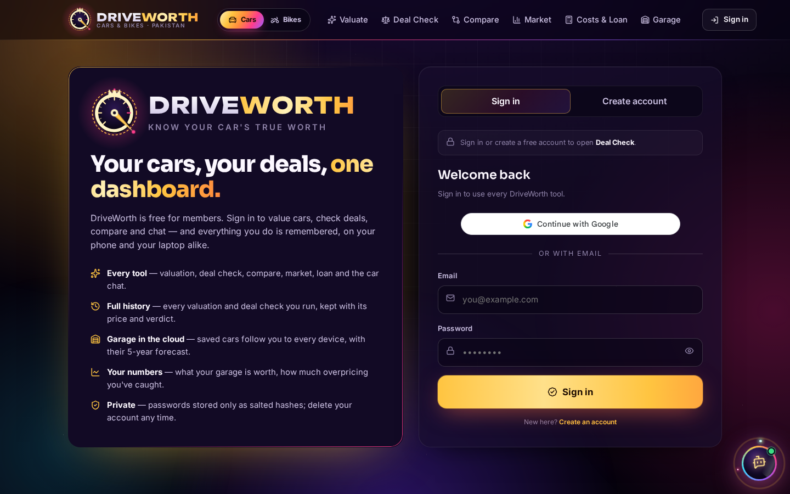
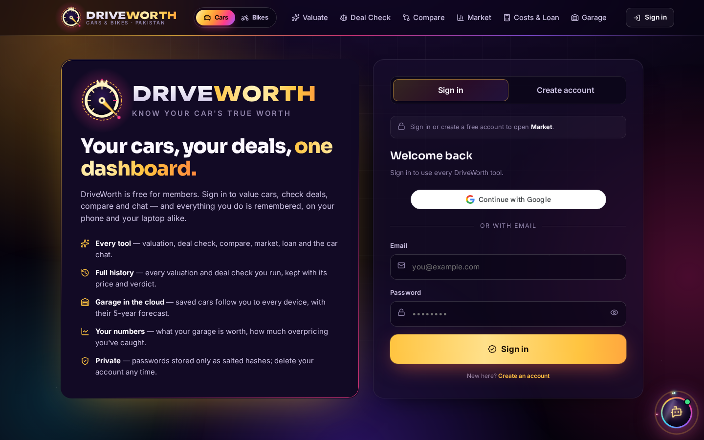
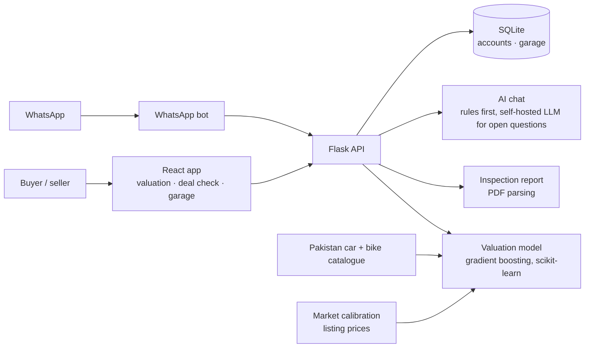

# DriveWorth

**Machine learning & data analysis**

Used-car pricing for Pakistan, from a 1989 Mehran to this year's Fronx. DriveWorth prices a car from its condition, history and papers, points out where the story does not add up, and tells you what to say when you sit down to agree a price.

[**Open the live demo**](https://driveworth.twinstackstudio.com) · [**Work with TwinStack Studio**](https://twinstackstudio.com/contact)

> **Note:** The used-car listings are simulated from a catalogue, not scraped, so the accuracy describes that simulated market and valuations are expert-informed estimates. Real sale prices reported by users are collected to calibrate the model over time.

## What it does

- Price model chosen from Ridge, Random Forest and Gradient Boosting by cross-validation: 96.7% accurate on 22,500 held-out listings, 98.3% within ±10%
- A four-step valuation with twenty plain questions, the eight CarSure section scores, or the full 135-item inspection checklist; an inspection report PDF fills itself in
- Every result has a price range, a factor-by-factor breakdown, red flags and a bargaining brief
- Deal Check gives a verdict on a seller's asking price with an opening offer and a walk-away price
- Five-year price forecast with sell or hold advice, side-by-side compare and a market overview
- A car-savvy chat assistant on the site and on WhatsApp that understands Roman Urdu questions and nicknames
- Cars and bikes, with a live price board on the home page

## Screenshots

| Valuation | Deal Check |
| --- | --- |
|  |  |

| Compare | Market |
| --- | --- |
|  |  |

## Technology

| Layer | Stack |
| --- | --- |
| Machine learning | scikit-learn, pandas, Gradient Boosting |
| Language AI | Self-hosted LLM, WhatsApp Cloud API |
| Backend | Python, Flask, SQLite, PyMuPDF |
| Frontend | React, Vite |

## Architecture

## Source code

This is the public showcase. The source code is kept in a private repository. Try the live demo above, and [contact TwinStack Studio](https://twinstackstudio.com/contact) for a walkthrough or a similar project.

## Built by TwinStack Studio

TwinStack Studio builds full-stack websites, web applications, mobile apps,
dashboards, portals, automation, and AI-powered products.

[GitHub](https://github.com/twinstack-studio) ·
[Website](https://twinstackstudio.com) ·
[Email](mailto:hello@twinstackstudio.com)

© 2026 TwinStack Studio. All rights reserved. See [LICENSE](./LICENSE).
